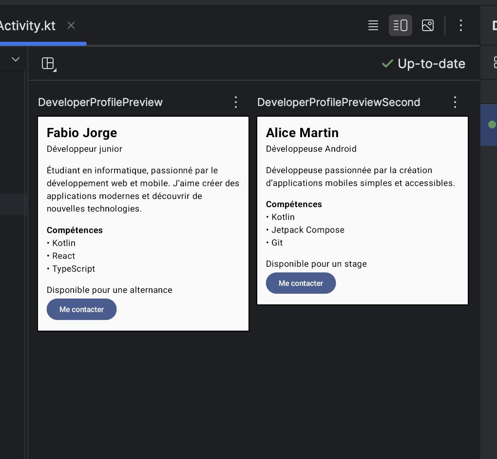

# Fiche Profil — Jetpack Compose

## Description

Cette application Android a été réalisée avec Kotlin et Jetpack Compose.

L'objectif est de créer une fiche de profil développeur composée de plusieurs composants réutilisables. La fiche affiche le nom, le rôle, une courte biographie, une liste de compétences, la disponibilité ainsi qu'un bouton « Me contacter ».

## Notions utilisées

- Jetpack Compose
- `@Composable`
- `Column`
- `Text`
- `Button`
- `Spacer`
- `Modifier`
- `padding`
- `fillMaxWidth`
- Paramètres de composables
- Callback avec `onClick`
- `@Preview`

## Questions

### 1. Pourquoi découper l'UI en plusieurs composables ?

Découper l'interface en plusieurs composables permet de mieux organiser le code. Chaque composant possède un rôle précis et peut être réutilisé plus facilement.

Par exemple, `ProfileHeader` est responsable de l'affichage du nom et du rôle, tandis que `SkillsSection` s'occupe des compétences.

### 2. Quel est l'intérêt de passer les données en paramètres ?

Passer les données en paramètres permet de rendre les composables réutilisables.

Par exemple, `DeveloperProfile` peut afficher Fabio ou Alice sans avoir besoin de créer deux interfaces différentes. Il suffit de lui transmettre des données différentes.

### 3. Pourquoi utiliser `modifier: Modifier = Modifier` ?

Cela permet au composant qui appelle le composable de personnaliser son affichage sans modifier directement son fonctionnement.

Le paramètre possède une valeur par défaut, ce qui permet également d'utiliser le composable sans être obligé de fournir un `Modifier`.

### 4. Quelle différence entre padding externe et padding interne ?

Le padding externe correspond à l'espace appliqué autour d'un composant par son parent.

Le padding interne correspond à l'espace ajouté à l'intérieur du composant afin d'éloigner son contenu de ses bords.

Dans le projet, `DeveloperProfile` reçoit notamment un `Modifier` depuis son parent et ajoute ensuite son propre `padding(16.dp)`.

### 5. Pourquoi l'ordre des modifiers est-il important ?

Les modifiers sont appliqués dans l'ordre dans lequel ils sont écrits. Changer leur ordre peut donc modifier le résultat visuel ou le comportement du composant.

Dans le projet, on utilise par exemple :

```kotlin
modifier
    .fillMaxWidth()
    .padding(16.dp)
```

Le composant prend d'abord la largeur disponible puis le padding est appliqué.

### 6. Comment rendre un composable réutilisable ?

Un composable devient plus réutilisable lorsqu'il ne contient pas toutes ses données en dur.

Il peut recevoir ses données grâce à des paramètres et permettre la personnalisation de son apparence avec un `Modifier`.

Par exemple :

```kotlin
@Composable
fun ProfileHeader(
    name: String,
    role: String,
    modifier: Modifier = Modifier
)
```

Le même `ProfileHeader` peut ainsi afficher différents noms et différents rôles.

### 7. Pourquoi remonter les actions via des callbacks ?

Un callback permet au composable de signaler qu'une action a été effectuée sans décider lui-même de ce qui doit se produire.

Dans le projet, `ContactButton` reçoit :

```kotlin
onClick: () -> Unit
```

Le bouton appelle cette fonction lorsqu'il est utilisé. Cela permet de séparer l'affichage du bouton de l'action qui sera exécutée.

## Previews

Deux previews sont présentes dans le projet :

- `DeveloperProfilePreview` affiche le profil de Fabio Jorge.
- `DeveloperProfilePreviewSecond` affiche le profil d'Alice Martin.

Elles permettent de vérifier que le même composable peut fonctionner avec des données différentes.

## Capture d'écran

Ajouter ici la capture d'écran montrant les previews et/ou l'application exécutée sur l'émulateur.

```markdown

```